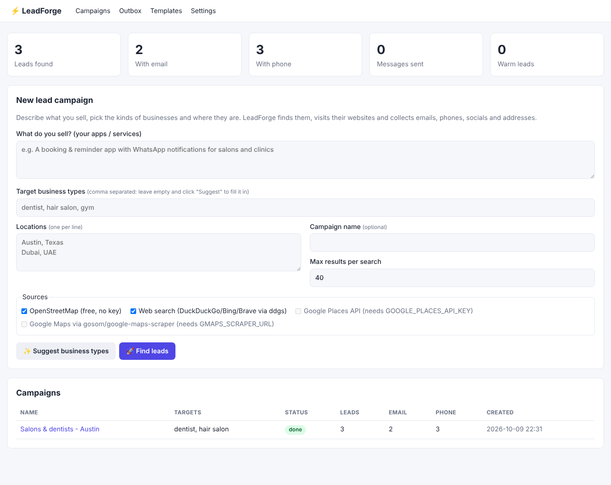
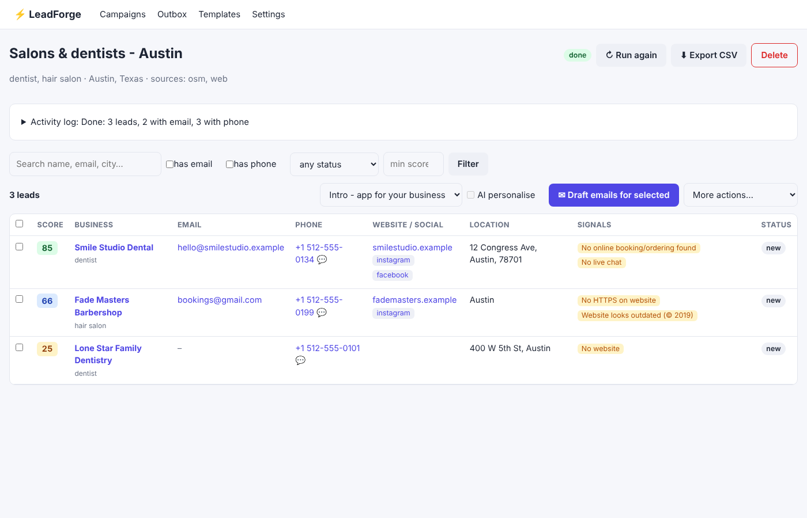
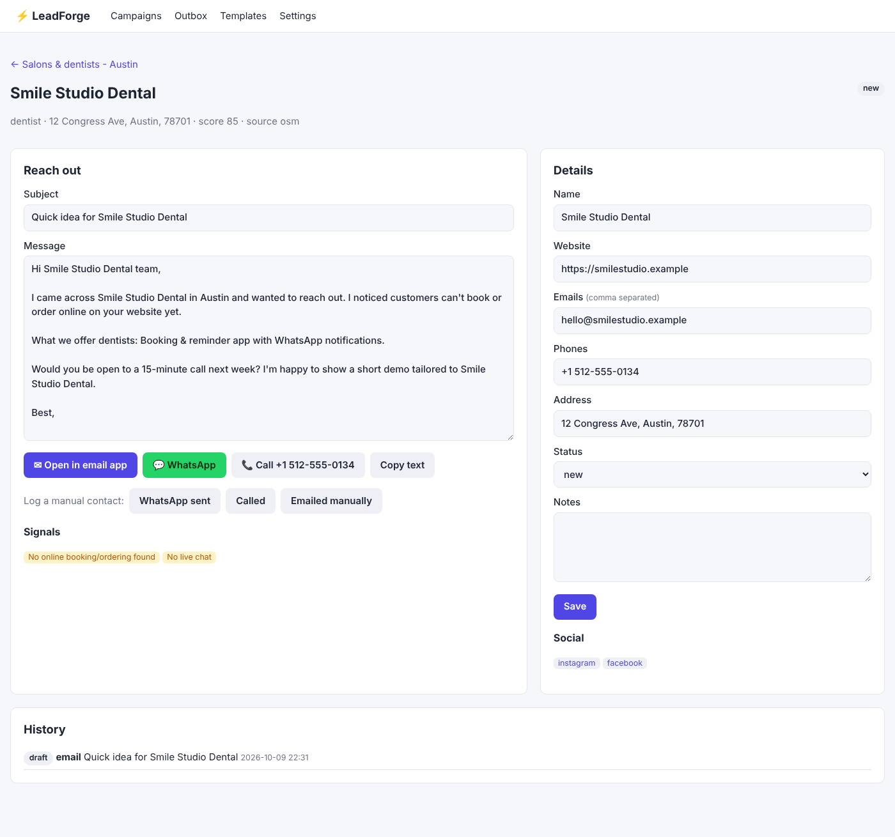

# ⚡ LeadForge

**Self-hosted lead generation and outreach for people who sell apps and automation to businesses.**

Tell LeadForge what you sell and where your customers are. It will:

1. **Pick targets.** It suggests the business types most likely to buy your service (e.g. a *booking app* → dentists, salons, gyms, physios), optionally using Claude.
2. **Find businesses** in any city or country, using free open data (OpenStreetMap) and web metasearch, plus Google Maps / Google Places if you enable them.
3. **Visit each business website** (respecting `robots.txt`) and extract **emails, phone numbers, social profiles (Instagram, Facebook, LinkedIn, WhatsApp…) and address**.
4. **Spot sales signals.** It flags things like *no online booking*, *not mobile-friendly*, *no HTTPS* or *outdated website* that make your pitch relevant.
5. **Score and rank** every lead by how reachable and promising it is.
6. **Help you reach out.** It drafts personalised emails from templates (optionally rewritten by AI for each business), sends them through your own SMTP with daily limits, and offers one-click WhatsApp, call and email-app links. It also tracks every lead through `new → contacted → replied → interested → won`.





---

## Quick start

### Option A: Python (3.10+)

```bash
git clone <this repo> leadforge && cd leadforge
python -m venv .venv && source .venv/bin/activate      # Windows: .venv\Scripts\activate
pip install -r requirements.txt
cp .env.example .env                                    # then edit it
python -m leadforge.cli serve                           # open http://127.0.0.1:8000
```

### Option B: Docker

```bash
cp .env.example .env
docker compose up -d                                    # http://localhost:8000
# with the Google Maps scraper as an extra source:
docker compose --profile gmaps up -d                    # and set GMAPS_SCRAPER_URL=http://gmaps:8080
```

### Command line only

```bash
python -m leadforge.cli find \
  --services "Booking & reminder app with WhatsApp notifications" \
  --location "Austin, Texas" --location "Dubai, UAE" \
  --sources osm,web --limit 40 --out leads.csv
```

If you omit `--targets`, LeadForge picks business types from `--services`.

---

## How to use the dashboard

1. **Campaigns → New lead campaign.** Describe what you sell, then click **✨ Suggest business types** (or type your own), add one location per line and choose sources. Click **🚀 Find leads**.
2. Watch the activity log while it searches and crawls. Leads appear sorted by score.
3. Filter (`has email`, `has phone`, min score, status), then select leads and click **✉ Draft emails** (tick **AI personalise** if you set an Anthropic key).
4. In the **Outbox**, review and edit each draft, then **Queue** it and click **▶ Send queued**. Without SMTP, use **Open in mail app**.
5. Open any lead to message it on **WhatsApp**, **call** it, add notes and update its status.
6. **Export CSV** at any time to import into your CRM or Google Sheets.

---

## Lead sources

| Source | Key needed | What you get | Notes |
|---|---|---|---|
| **OpenStreetMap** (Nominatim + Overpass) | No | Name, address, coordinates, often phone, website and email | Free, legal (ODbL). Best coverage in Europe and big cities. |
| **Web search** ([`ddgs`](https://pypi.org/project/ddgs/) metasearch) | No | Business websites | Directories such as Yelp and Facebook are skipped, and the website crawler fills in the contacts. |
| **Google Places API** | `GOOGLE_PLACES_API_KEY` | Name, phone, website, rating, reviews | Official API, with a free monthly credit, then paid. |
| **Google Maps scraper** ([gosom/google-maps-scraper](https://github.com/gosom/google-maps-scraper), MIT) | `GMAPS_SCRAPER_URL` | The richest data, including emails | Runs as a separate container. Scraping Google Maps may violate Google's ToS, so use it at your own risk. |

Every lead goes through the **website enricher** (`leadforge/enrich.py`). It reads the homepage and up to 4 contact/about/impressum pages, then extracts:

- **emails**: from `mailto:` links, page text, `name [at] domain [dot] com` obfuscation and schema.org JSON-LD. Emails on the business's own domain are ranked first.
- **phones**: from `tel:` links, JSON-LD and page text, validated and formatted with Google's `libphonenumber`.
- **socials**: Facebook, Instagram, LinkedIn, X, TikTok, YouTube and WhatsApp.
- **sales signals**: no online booking, no mobile app, no live chat, no HTTPS, not mobile-friendly, outdated copyright, sells online.

Duplicates across sources are merged by website domain (or by name + street).

## Configuration

Everything is configured in `.env` (see [`.env.example`](.env.example)):

| Variable | Purpose |
|---|---|
| `APP_PASSWORD` | Password-protects the dashboard. **Set this if you deploy it publicly.** |
| `PUBLIC_BASE_URL`, `SECRET_KEY` | Used for the signed one-click unsubscribe links in emails |
| `SMTP_*`, `FROM_EMAIL`, `FROM_NAME`, `SENDER_COMPANY` | Your mailbox for sending (Gmail/Google Workspace app password, Outlook, Zoho, Mailgun, SES, Brevo…) |
| `SENDER_POSTAL_ADDRESS` | Added to every email (required by CAN-SPAM and others) |
| `DAILY_SEND_LIMIT`, `SEND_DELAY_SECONDS` | Keep volume low to protect your domain reputation (start with 20–50/day) |
| `ANTHROPIC_API_KEY` | Enables AI target suggestions and per-lead email personalisation |
| `GOOGLE_PLACES_API_KEY`, `GMAPS_SCRAPER_URL` | Extra lead sources |

## Email templates

Templates support these placeholders: `{{business_name}}`, `{{category}}`, `{{category_plural}}`, `{{city}}`, `{{website}}`, `{{rating}}`, `{{services}}`, `{{my_name}}`, `{{my_company}}`, plus `{{signal_line}}`. `{{signal_line}}` is a sentence based on what was found on the lead's website, e.g. *"I noticed customers can't book or order online on your website yet."* Jinja expressions work too.

## JSON API

- `GET /api/campaigns`
- `GET /api/campaigns/{id}/leads?has_email=1&min_score=50`

Use these to push leads into n8n, Zapier, Make or your CRM.

## Responsible use (please read)

Cold outreach is legal in many places **if you do it right**, and the app is built to make that the default:

- Every email sent via SMTP includes your identity, postal address and a **one-click unsubscribe link** (+ `List-Unsubscribe` headers). Unsubscribes are permanent and checked before every send.
- The crawler identifies itself, **respects `robots.txt`** and only reads public business pages.
- WhatsApp is **click-to-chat only** (you send each message yourself). Bulk automated WhatsApp messages to people who haven't opted in violate WhatsApp's terms and get numbers banned.
- **Your obligations:** follow the rules where you and your leads are, e.g. CAN-SPAM (US), GDPR/PECR (EU/UK; B2B outreach usually relies on *legitimate interest*, so keep it relevant, honest and easy to opt out of), CASL (Canada), and the UAE/Saudi telecom and data rules. Contact businesses, not private individuals, and keep volumes modest.

## Development

```bash
pip install -r requirements-dev.txt
pytest -q
```

Project layout:

```
leadforge/
  main.py          FastAPI app + routes
  pipeline.py      campaign runner (discover → dedupe → enrich → score)
  sources/         osm.py, websearch.py, google_places.py, gmaps_scraper.py
  enrich.py        website crawler + email/phone/social extraction + signals + scoring
  outreach.py      templates, SMTP sending, unsubscribe, WhatsApp/tel/mailto links
  ai.py            optional Claude integration
  db.py            SQLite schema and helpers
  cli.py           command line
  templates/       Jinja HTML templates
```

## License

MIT
